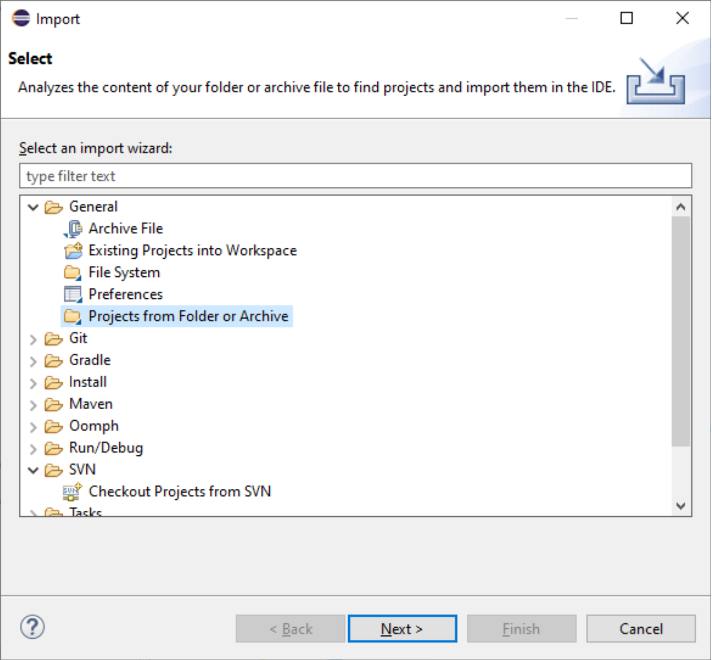
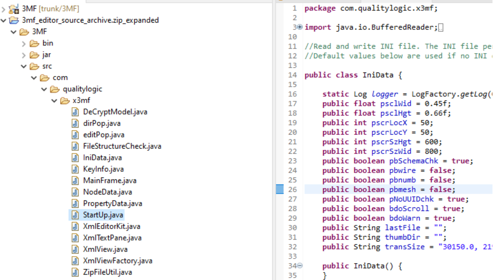
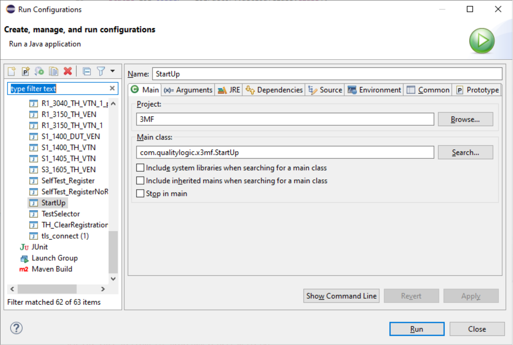

# 3MF Editor Build Instructions for Eclipse IDE

Version 1.00

| **Version** | **Changes** | **Date/Editor** |
| --- | --- | --- |
| 1.0 | Initial Release | JZ – 10/1/22 |

## 3MF Editor Build Instructions for Eclipse IDE

### Prerequisites:

- Windows 10 or later

- Java version 17.0.1 or later installed

- Eclipse IDE for Java Developers, version 2021-12 or later installed

### Setup:

- Download the 3mf\_Editor from Github.

- From the Eclipse File menu, select import, General, Projects from Folder or Archive, then click Next

- Click the Directory button, browse to the 3MF folder and select, check the “3MF” checkbox, and click Finish. The project will be unzipped into the Eclipse-workspace directory in you Windows user subdirectory. The project should now be accessible from the Eclipse Package Explorer.

- From the package explore drill down to the StartUp.Java file. Right click on this file and select “Run As” , “Run Configuration”

- From the run configuration dialog. Select “StartUp” from the list of methods and click run. The the 3MF Editor should launch.

- Subsequent launches of the  3mF Editor can be done from the tool bar at the top of Eclipse by clicking the run startup or debug startup icons.
