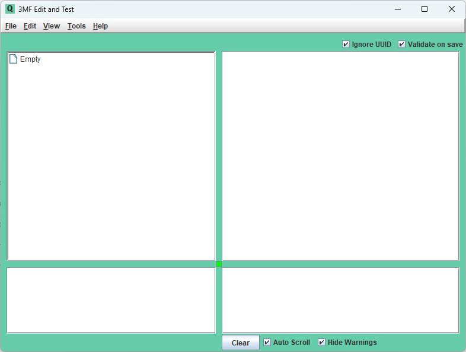
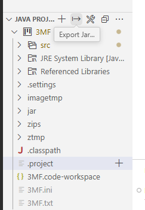
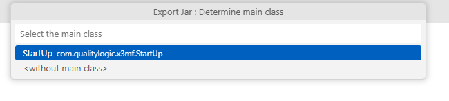
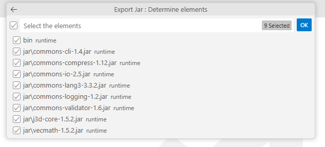

# 3MF Editor Build Instructions for VSCode IDE

Version 1.00

| **Version** | **Changes** | **Date/Editor** |
| --- | --- | --- |
| 1.0 | Initial Release | JG – 9/1/25 |

## 3MF Editor Build Instructions for VSCode IDE

### Prerequisites:

- Windows 10 or later

- Java version 17.0.1 or later installed

- VSCode with Microsoft Extension Pack for Java.

### Setup:

- Download the 3mf\_Editor from Github.

- From the VSCode File menu, select Open Workspace from File, and select `3MF.code-workspace`.

- The 3MF workspace should now be accessible from the project Explorer.

### Execution:

- In the Run and Debug view, select **3MF Editor**. The saved `.vscode/launch.json` targets `com.qualitylogic.x3mf.StartUp` in project `3MF`, with the project folder as its working directory.

- Press **Ctrl+F5** (Run Without Debugging) to build and launch the editor normally, or **F5** to build and launch with the Java debugger. The workspace enables building before launch.

- This configuration works regardless of the active file. If VS Code offers to install a debugger for an Ignore file, dismiss the prompt, open `3MF.code-workspace`, and select **3MF Editor** in Run and Debug before trying again.

### Build JAR File:

- From the JAVA PROJECT folder in the project explorer, click on the Export Jar button:

- Select the main class in the center above of VSCode:

- Select all the run time elements and click OK:

- It will generate 3MF.jar in the 3mf\_Editor\\3MF folder.

- Just rename it to 3MFedit.jar and now it is ready to execute or move to your execution folder, together with the 3MF Consolidated Schema, from the 3MF Test Suite.
