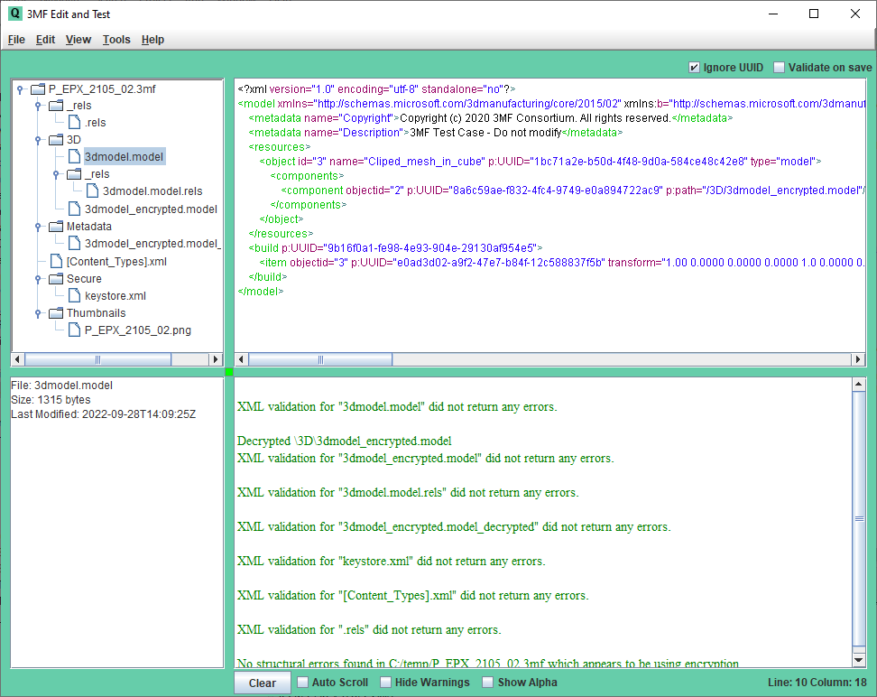

# 3MF Editor Guide

Version 1.00

| **Version** | **Changes** | **Date/Editor** |
| --- | --- | --- |
| 1.0 | Initial Release | JZ – 10/1/22 |

## Editor Overview

This utilities primary use case is the development of test cases and the validation of 3MF packages against the e 3MF schema and specification conformance rules. From a tree view, the 3MF package structure can be edited including cutting and pasting parts. Any selected 3MF part with XML can be edited.

A secondary use case for this utility is to enable ad hoc editing of 3MF files to assist with learning about the 3MF imaging format and the validation of 3MF files to determine if the conform to the 3MF standard.



## Installation and Quick Start

**Install as follows:**

1. Install Java on your computer. Do “java -version” to confirm Java is accessible from the command line. Note that the Editor has only been tested on a Windows computer.

2. The 3MF Editor is distributed with the following set of files. Unzip these files into a directory.

    - 3MFedit.jar – The editor executable. Double click to run

    - sample\_3mf\_files

3. The Editor has a properties file that can be edited from within the GUI or with a text editor (they end in .txt). The property files will be generated the first time 3MF Editor is run

4. Copy the test files onto a local or shared drive. Each test case has a properties file with an “rnf” extension. The properties files released with the test suite have system path references that will be automatically updated when the Test Manager is used to send test files to the printer.

5. Prior to starting the 3MF Editor, note the location of the consolidated 3MF schema. The schema is shipped with the 3MF Editor package, but is only required if you plan to validate 3MF files with the Editor. You will be prompted for some of this information the first time you start the 3MF Editor or may need to input this information after startup using the menu option in the 3MF Editor.

### Quick Start

_**Use the Editor to edit, validate, and print 3MF files**_

- Start the Editor and use the **File/Load** menu option to select the first test case in the Positive directory, you can click on the various parts of the 3MF package displayed in the tree to see the XML content.

- You can edit the 3MF Package by right clicking on an item in the 3MF package structure tree

- You can edit 3MF parts the contain XML by left clicking on the in the 3MF package tree, the editing them in the edit window. Right click options are available in the edit window to cut, copy, and paste text, as well as do schema validation of the current XML displayed.

- When you are done editing, you can select From the **Tools** menu select **Validate Package, Schema, and Structure** to confirm that there are no errors in the file. The edited file can be save with options in the File menu.

## 3MF Editor Menu Options

The Editor provides the following functionality:

- To validate a 3MF file against the schema/structure rules in the 3MF specifications

- To edit the location and name of the OPC parts contained in a 3MF Package

- To edit the XML content of various OPC parts

Note that the 3MF Editor’s primary purpose was to aid in the development of test cases, which are typically fairly small documents. Thus the 3MF Editor cannot edit or validate OPC Parts whose uncompressed size is greater than 75 MB.


### Screen Layout and Context Menus:

- **Upper Left** – A tree displaying the current OPC file structure. Clicking on any item will cause the content to be displayed in the edit panel (to the right). Right clicking on nodes in the tree presents a context menu with the ability to rename, add, delete, insert, or paste directories or files in the tree, as well as display 3d previews of individual objects.

- **Upper Right** – This area is used to display the content of an item in the tree. Typically, this will be an XML document or an image. Right clicking with the cursor in in the text area presents a context menu that includes the ability to cut, copy, paste, select, find, undo, and redo XML text. Validation of the XML can also be initiated from the context menu. Note that Control-Z can be used for undo as well.

- **Lower Left** – Statistics on the currently selected OPC part such as file size.

- **Lower Right** – This is a console window that displays status messages when test cases are validated or printed.

- The size of the display areas can be modified by dragging the small square anchor at the intersect point of the 4 windows in the center of the display

### Menu Options:

- **File**

    - **Load** – Loads 3MF file

    - **Save –** Saves the current 3MF including recent edits

    - **Save As**

    - **Close**

    - **Update Backup** – Each time a 3MF file is loaded, a backup file is automatically created. This menu option forces the backup file to be updated with currently edited instance of the 3MF file in the Editor.

    - **Load Backup**

    - **Set Schema Location** – Sets the location for the consolidated 3MF schema, downloaded from the 3MF Test Suite.

    - **Structure Check Override On** – This toggles a property setting that controls whether structure validation will occur even though the 3MF file failed schema validation.

    - **Exit**

- **Edit**

    - **Cut**

    - **Copy**

    - **Paste**

    - **Select All**

    - **Find** – Searches for text in the upper right quadrant status display.

    - **Find Again**

    - **Undo**

    - **ReDo**

- **View**

    - **Increase Font** – Modifies the size of the font used to display text.

    - **Decrease Font**

    - **Dark Mode** – Switches the four main panes between light and dark colors.
      The preference is saved between sessions. Images retain their original colors.

- **Tools**

    - **View 3MF** – Launches the system 3MF Viewer, typically 3D Builder

    - **Edit Properties File** – This launches the default system text editor and loads the properties file into that editor. IMPORTANT: _After editing and saving, the properties file must be reloaded using the option below._

    - **Reload Properties File**

    - **PrettyPrint XML in Editor** – Formats the XML in the edit window.

    - **Schema Check Part Being Edited** – Validates the currently displayed XML against the schema.

    - **Schema Check, All Parts** – Validates the schema for all parts in the OPC Package.

    - **Validate 3MF File, Schema, and Structure** – Validates both the schema and structure of the entire 3MF package.

- **Help**

    - **User Guide**

    - **About**

### Other User controls

The following additional checkbox controls are available in the Editor GUI:

- **Ignore UUID**– Ignore missing and duplicate UUID attributes in model part

- **Validate on Save** checkbox - If checked, each time the edited XML is saved, it is validated against the schema.

- **Clear** button – If clicked, clears the console window.

- **Auto Scroll** checkbox – Enables or disables the cursor being moved to the bottom of the console log after each post.

- **Hide Warnings –** Hide warnings when validating the structure of a test file

- **Show Alpha –** When viewing an image, show only the alpha channel data, with white as opaque and black as transparent.

### Properties

The configuration file has annotations that describe each of the options. The comments below point out a few important characteristics of the Editor, followed by a listing of the properties.

```properties
# Use RELOAD PROPERTIES FILE menu option after editing this file
# Working directory
 pcurrentDir = "C:/Temp/”
# Schema location
 pschemaLoc = "C:/Users/Jim/OneDrive/3MF Project/3MF Specifications/Schemas"
# Indents used for pretty Printing
 ppindent = "4"
# Maximum errors reported for 3MF file structure validation
 iErrMaxStructure = "9"
# Maximum errors for reported for 3MF schema validation
 iErrMaxValidataion = "9"
# If true, do structure checks even if there are schema validation errors
 bStructureChkWerrors = "false"
```
