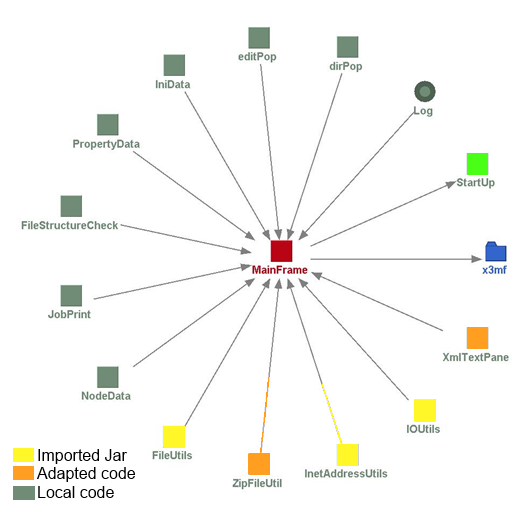

# 3MF Editor Source Code Structure

Version 1.00

| **Version** | **Changes** | **Date/Editor** |
| --- | --- | --- |
| 1.0 | Initial Release | JZ – 10/1/22 |

## 3MF Editor Source Code Structure

The software for the HP 3MF project was developed in Eclipse Mars for java Developers

## Java Requirements

The following jars are required and located in the subdirectory jars:

- commons-io-2.5.jar – org.apache.commons.io

- commons-codec-1.9.jar – org.apache.commons.codec

- commons-logging-1.2.jar – org.apache.commons.logging

- commons-validator-1.6.jar – org.apache.commons.validator

- commons-lang3-3.3.2.jar – org.apache.commons.lang3

- commons-compress-1.12.jar – org.apache.commons.compress

## Startup

There are a number of images and the user’s guide that are located in 3MF/src/resources. The images provide icons for use in title bars and background for the about screen. The user’s guide is extracted to the root of the install on the first use.

The QualityLogic 3mf java source code is stored in the source package com.qualitylogic.x3mf, thus the files are found in 3MF/src/com/qualitylogic/x3mf. The editor is started from StartUp.java.

## Common Support Classes

The Ini class saves and restores window information so variables like the state the window was in at last use can be restored. The ini contains information like the window size, location, and the state of certain global checkboxes.

The Property classes contain user changeable values such as optional conditions and such. The classes generally consist of the default value for each variable they set/save, a method to read and parse the input. The program has an Edit Properties File/Reload Properties File command in the Tools menu. This will launch the default editor. If a file does not exist on save, one is created with either the default startup values (as stored in the public variables at the top of each class) or with whatever has changed within the programs. The process in the programs is very simple. Read the existing file in, if available. Parse the existing file to either read in a value, or update the value for output. On the write, there is an additional step to write out the values that do not exist in the file that was found for input. You may delete any file and it will be recreated on exit or sooner, depending on the user’s actions. Lines that start with # are saved for output, but otherwise ignored completely. All lines are trimmed prior to parsing.

Note that the code is exceedingly redundant and could be cleaned up by creating methods to parse an expected double, Boolean, integer… but what is here currently works reliably and is simple to expand when you understand the basic process.

- IniData – reads 3MF.ini

- PropertyData – reads 3MF.txt

Some other support classes that were acquired from open sources on the internet and modified to this purpose are:

- ZipFileUtil which provides some easier methods for creating zip files. This was brought in late and might be used to replace some other sections of the code where zip files are created.

- XmlEditorKit, XMLTextPane, XmlView, XmlViewFactory are used in the editor to display the xml in a color coded fashion. This is an extension of JTextPane. The use of this code causes an issue with the block undo in that the Xml modifies the wrapping around the text as it goes in to create the highlighting, so when a block paste occurs, the undo is broken down into a line by line undo.

Please note that the programs also write to the java console window (or DOS window on Windows) with some information as info and more information with debug in the usual LogFactory method.

## Editor Code

The primary class for the editor is MainFrame. The upper right holds a tree, the upper left is text, xml, or an image. The lower left is text for statistics, and the lower right is a console for returning information from other threads or api requests. The console in MainFrame is still HTML. JScrollPanes are placed in each of these areas, which then contain an appropriate text, xml, jtree, or image container. SpringLayout is used to place each item in the window properly relative to one another. The SpringLayout is located in the setupFrame() routine. A short overview of the editor is as follows, ignoring the basics of startup:

A 3mf file is chosen to be loaded. Look for the action of loadI as a starting point in the code. Searching backward in the code will take you straight to it.

A backup of the file is created.

Settings are reinitialized such as xmlChanged to false. This is used throughout the program to track whether changes have occurred and generally to force a save query when moving away from a file so that changes are not lost. The nd instantiation of NodeData is cleared. This is a class that was created to track the nodes in a tree. When a user moves around in the tree, the locations are tracked in the nd structure. For instance, if you edit a file, move to another, then move back to that file, the location of the caret that the xmlEd was last at is restored.

The mfPane (upper right) is set to a new getTree. This will be a tree structure of the zipped 3mf file called “tree”. CreateNodes is called to generate the tree.

The file is examined and the structure of the 3mf file is loaded into the tree and the nd values updated so that each file in the tree has a place to maintain the last state of the file in the editor.

From here much of what will occur is controlled by tree.addTreeSelectionListener as you change selections in the tree and tree.addMouseListener if you right-click a node of the tree. The right-click will launch dirPop which offers various functions depending on what was clicked, such as renaming a file, adding a new file…. EditPop and jobPop were based on this. EditPop is for the upper right window and gives you the usual cut/paste/undo options as appropriate to the situation. JobPop is a right click option in the print manager for deleting jobs, printing processed jobs and such. All of these communicate back via the listener the result or action to do.

A button has been placed in the middle of the four panes in the editor and managers. This button can be dragged around the screen which in turn causes the size of the windows to be adjusted. The btnCH.addMouseMotionListener handles readjustment of the pane sizes. This is the only function of the button.

### Editor Local Classes Used

- dirPop: This class provides the right-click popup for the tree structure. This allows for files to be renamed, inserted, copied, pasted, and other similar functions. Some items may be disabled where not appropriate.

- editPop: This class provides the right-click popup in the xml editing pane for actions like cut and paste. This primarily reflects the menu items that are available for editing and communicates back the action that needs to occur as opposed to dirPop which generally implements the action locally, such as renaming a file.

- IniData: read/writes the current state of the window. On startup, this is read in order to restore the window to the same location and size during the programs last operation.

- PropertyData: reads/writes the user variables.

- FileStructureCheck: This runs an extensive analysis of the 3mf file to determine is the file structure meets the requirements for a 3mf file.

- JobPrint: handles queuing files to the printer to be processed and if requested, schedules the file to be printed. Uses a REST client to post jobs and jsch to execute an ssh session to schedule a build.

- NodeData: this provides a structure to store the viewing details of each xml file in a 3mf so that when you move through the tree looking at various elements of the files, you are placed back where you last looked.

- ZipFileUtil: provides a quick method to zip a directory.

- XmlTextPane: provides a text pane that color codes an xml file to make it clear when elements in a XML are not properly encoded.
